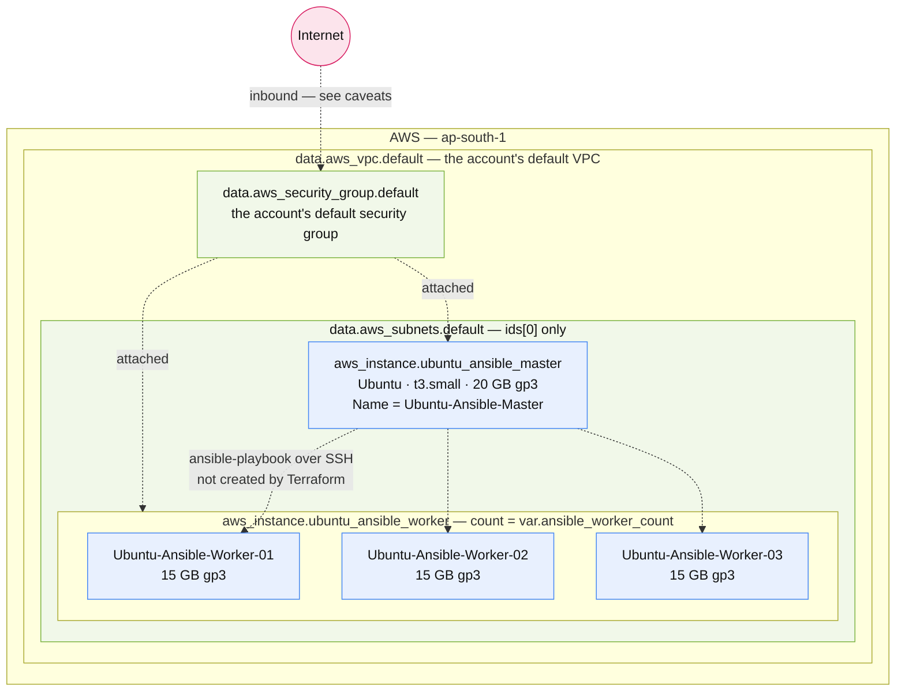

# ansible-control-node-and-workers

> Stands up an Ansible control node plus a fleet of managed worker nodes in the account's default VPC.

**Region:** `ap-south-1` (hard-coded) · **VPC:** reuses the account default VPC · **Provider:** `hashicorp/aws ~> 6.53` · **Terraform:** `>= 1.6.0`

## What this provisions

This stack creates the *hosts* for an Ansible lab: one control node (named "master" throughout the code) and a
configurable number of worker nodes, all running Ubuntu. Every instance lands in the account's existing default VPC,
reusing its default subnets and its default security group — this stack creates no networking of its own.

The worker fleet is driven by `count`, so scaling to more managed nodes is a one-line change to
`ansible_worker_count`. Workers are numbered (`Ubuntu-Ansible-Worker-01`, `-02`, …) and tagged `Environment = dev`,
which makes them addressable by tag. The control node is a single instance, given a slightly larger root volume than
the workers.

**Terraform does not install Ansible.** There are no `user_data` scripts, no `remote-exec` provisioners, and no
playbooks in this folder. This stack builds bare EC2 instances with an SSH key attached; installing the Ansible
packages, writing an inventory, and running playbooks against the workers is left entirely to you afterwards. The
diagram below marks that manual step explicitly.

### Resources created

| # | Resource | Terraform address | Key configuration |
|---|----------|-------------------|-------------------|
| 1 | Ansible control node | `aws_instance.ubuntu_ansible_master` | `var.ubuntu_ansible_master_ami_id`, `var.ubuntu_ansible_master_instance_type`, `var.key_name`, subnet `data.aws_subnets.default.ids[0]`, default SG, 20 GB `gp3` root volume, tagged `Name = Ubuntu-Ansible-Master` |
| 2 | Ansible worker fleet | `aws_instance.ubuntu_ansible_worker` | Same as above but with the worker AMI/instance-type variables and a 15 GB `gp3` root volume. `count = var.ansible_worker_count` (3 in the committed tfvars). Tagged `Name = Ubuntu-Ansible-Worker-%02d` and `Environment = dev` |

Each instance also receives a public IP, because the default subnets have `map_public_ip_on_launch` enabled. There is
no Elastic IP, so those addresses change if an instance is stopped and started.

### Data sources (lookups only — nothing is created)

| Data source | Purpose |
|-------------|---------|
| `data.aws_vpc.default` | Resolves the account's default VPC. The stack has no `vpc_id` variable — it is hard-wired to whatever the account's default VPC happens to be. |
| `data.aws_subnets.default` | Lists every subnet in that VPC. Only `ids[0]` is ever used, so all instances land in one (effectively arbitrary) subnet. |
| `data.aws_security_group.default` | Resolves the VPC's default security group by name. This SG is attached to every instance. |

## Architecture



*Instance counts and types shown above reflect the committed `terraform.tfvars` (3 workers, `t3.small`). The code
defaults are 1 worker and `t3.micro`.*

## Inputs

| Variable | Type | Default | Description |
|----------|------|---------|-------------|
| `ubuntu_ansible_master_ami_id` | `string` | *(required)* | The AMI ID to use for the Ubuntu Ansible master instance |
| `ubuntu_ansible_worker_ami_id` | `string` | *(required)* | The AMI ID to use for the Ubuntu Ansible worker instances |
| `ansible_worker_count` | `number` | `1` | The number of Ubuntu Ansible worker instances to create |
| `key_name` | `string` | *(required)* | The EC2 key pair name to use for the instances |
| `ubuntu_ansible_master_instance_type` | `string` | `"t3.micro"` | The EC2 instance type to use for the Ubuntu Ansible master |
| `ubuntu_ansible_worker_instance_type` | `string` | `"t3.micro"` | The EC2 instance type to use for the Ubuntu Ansible workers |

`ansible_worker_count` is validated: it must be a positive whole number, so `0` and `2.5` are rejected at plan time.

Instance type sizing crib, carried over from the code comments:
`t3.micro` = 1 GB · `t3.small` = 2 GB · `c7i-flex.large` = 4 GB · `m7i-flex.large` = 8 GB.

## Outputs

| Output | Description |
|--------|-------------|
| `ubuntu_ansible_master_instance` | ID and public IP of the Ubuntu Ansible master |
| `ubuntu_ansible_master_ssh_command` | SSH command for the Ubuntu Ansible master |
| `ubuntu_ansible_workers` | Connection details for the numbered Ubuntu Ansible workers, keyed by each instance's `Name` tag. Each entry carries `id`, `name`, `environment`, `public_ip`, and a ready-made `ssh` string |

The `ubuntu_ansible_workers` output is shaped to be readable as an inventory starting point:

```bash
terraform output -json ubuntu_ansible_workers
```

## Prerequisites

- AWS credentials in the environment with permission to run EC2 instances.
- An existing EC2 key pair in `ap-south-1` whose name is passed as `key_name`, with the matching `.pem` on the
  machine you intend to SSH from.
- A **default VPC that still exists** in the account. If the default VPC has been deleted, every lookup here fails
  and the stack cannot plan.
- Ubuntu AMI IDs for `ap-south-1`. The stack takes these as variables rather than looking them up, so they must be
  supplied — and they must be valid in the region the provider is pinned to.

## Deploy

This folder ships `terraform.tfvars.example`, and `terraform.tfvars` itself is gitignored. Copy it into place first:

```bash
cp terraform.tfvars.example terraform.tfvars
```

Then:

```bash
terraform init
terraform plan
terraform apply
```

Both AMI IDs and `key_name` are required variables with no usable defaults — `apply` fails without them.

```bash
terraform output ubuntu_ansible_master_ssh_command
```

## Notes and caveats

- **This does not install or configure Ansible.** Reading the folder name, it is easy to assume an Ansible control
  node comes ready to use. It does not — the instances are stock Ubuntu with an SSH key. Provisioning the tooling is
  a separate step you own.
- **SSH may not work out of the box.** All instances attach the account's **default** security group, whose AWS
  default has no inbound rule permitting SSH from the internet. The `ssh` strings in the outputs will therefore fail
  to connect unless someone has manually added an inbound rule to that group. This is the most likely first
  stumbling block.
- **No network isolation.** Everything runs in the account's default VPC alongside any other resource in the account
  that also uses it. There is no VPC boundary between this stack and unrelated workloads.
- **Single subnet, single AZ.** Despite `data.aws_subnets.default` resolving a list, only `ids[0]` is used. Every
  instance sits in the same subnet of the same availability zone, so there is no redundancy, and a subnet or AZ
  outage takes the whole fleet down.
- **Instances are not addressable by a stable IP.** No Elastic IP is allocated, so `public_ip` changes across
  stop/start. Anything pointing at these addresses — an inventory file, a DNS record — needs updating after a
  restart.
- **Master and workers share one AMI in practice.** `terraform.tfvars` sets `ubuntu_ansible_master_ami_id` and
  `ubuntu_ansible_worker_ami_id` to the same ID. The separate variables allow divergence, but nothing currently
  depends on it.
- **Tagging is inconsistent between the two roles.** Workers carry `Environment = dev`; the control node carries only
  `Name`. Any tag-based filtering for this stack will silently miss the master.
- **No remote backend.** State is written locally as `terraform.tfstate` and is gitignored, so it is unshared and lost
  with the folder.
