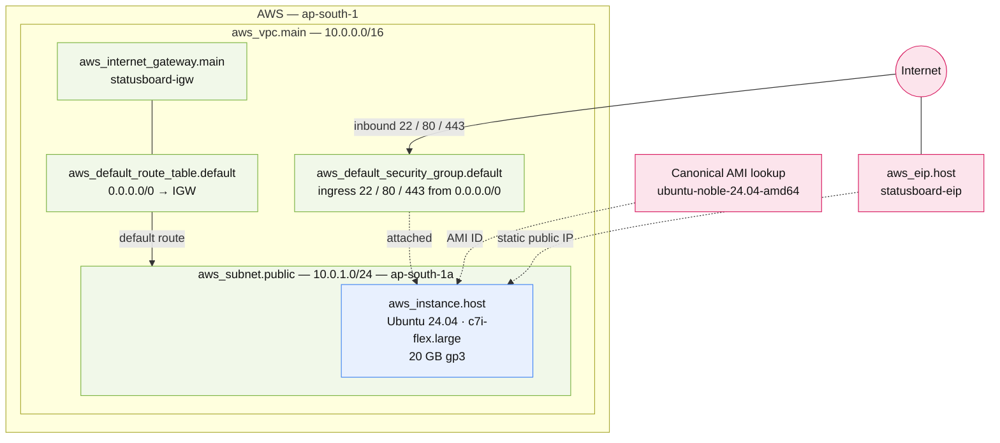

# custom-vpc-public-host

> Builds a self-contained VPC and places a single internet-facing Ubuntu 24.04 host in it, behind a static Elastic IP.

**Region:** `ap-south-1` (hard-coded) · **VPC:** creates a new VPC (`10.0.0.0/16`) · **Provider:** `hashicorp/aws ~> 6.53` · **Terraform:** `>= 1.6.0`

## What this provisions

This is the only stack in the repository that builds its own networking. It creates a VPC from scratch, attaches an
Internet Gateway, carves out one public subnet in a single availability zone, and routes that subnet's traffic to the
gateway through the VPC's route table. The VPC's *default* route table and *default* security group are adopted and
rewritten rather than new ones being created, so the account-default resources are repurposed as the stack's own.

On top of that network sits one EC2 instance running the newest Canonical Ubuntu 24.04 LTS AMI, which the stack
resolves at plan time rather than pinning to a hard-coded AMI ID. The instance is given a 20 GB gp3 root volume and
an Elastic IP so its public address survives stop/start cycles. The security group admits SSH, HTTP, and HTTPS from
anywhere, so the host is reachable from the open internet on those three ports — this is a public server, not a
private one behind a bastion.

The result is a single-VM deployment with its own isolated network, suitable for hosting one public service. All
resource names are prefixed by `project_name`, which defaults to `statusboard`.

### Resources created

| # | Resource | Terraform address | Key configuration |
|---|----------|-------------------|-------------------|
| 1 | VPC | `aws_vpc.main` | `10.0.0.0/16`, DNS support + DNS hostnames enabled, named `<project_name>-vpc` |
| 2 | Internet Gateway | `aws_internet_gateway.main` | Attached to `aws_vpc.main`, named `<project_name>-igw` |
| 3 | Public subnet | `aws_subnet.public` | `10.0.1.0/24` in `ap-south-1a`, `map_public_ip_on_launch = true`, named `<project_name>-public-subnet` |
| 4 | Default route table | `aws_default_route_table.default` | **Adopts** the VPC's default route table and adds `0.0.0.0/0` → Internet Gateway, named `<project_name>-default-rt` |
| 5 | Default security group | `aws_default_security_group.default` | **Adopts** the VPC's default SG; ingress `tcp/22`, `tcp/80`, `tcp/443` from `0.0.0.0/0`; all egress allowed, named `<project_name>-default-sg` |
| 6 | EC2 instance | `aws_instance.host` | Canonical Ubuntu 24.04 AMI, `var.instance_type`, in `aws_subnet.public`, attached to the default SG, 20 GB `gp3` root volume, named `<project_name>-server` |
| 7 | Elastic IP | `aws_eip.host` | Associated with `aws_instance.host`, named `<project_name>-eip` |

### Data sources (lookups only — nothing is created)

| Data source | Purpose |
|-------------|---------|
| `data.aws_ami.ubuntu` | Resolves the most recent Canonical Ubuntu 24.04 (`noble`) AMI, filtering on `hvm-ssd-gp3`, `x86_64`, `hvm` virtualization and EBS root device. Owners default to `099720109477` (Canonical). Because it is `most_recent`, the AMI ID can change between applies as Canonical publishes updates. |

## Architecture



## Inputs

| Variable | Type | Default | Description |
|----------|------|---------|-------------|
| `aws_region` | `string` | `"ap-south-1"` | AWS region to deploy resources in *(unused — `provider.tf` hard-codes the region)* |
| `ubuntu_ami_owners` | `list(string)` | `["099720109477"]` | Account IDs that own the AMI (Canonical for Ubuntu) |
| `vpc_cidr` | `string` | `"10.0.0.0/16"` | CIDR block for the new VPC |
| `subnet_cidr` | `string` | `"10.0.1.0/24"` | CIDR block for the public subnet |
| `availability_zone` | `string` | `"ap-south-1a"` | Availability zone for the subnet |
| `project_name` | `string` | `"statusboard"` | Prefix used to name VPC, subnet, and security group resources |
| `key_name` | `string` | `""` | The key name to use for the EC2 instance |
| `instance_type` | `string` | `""` | The instance type to use for the EC2 instance |

Instance type sizing crib, carried over from the code comments:
`t3.micro` = 1 GB · `t3.small` = 2 GB · `c7i-flex.large` = 4 GB · `m7i-flex.large` = 8 GB.

## Outputs

| Output | Description |
|--------|-------------|
| `vpc_id` | ID of the created VPC |
| `subnet_id` | ID of the created public subnet |
| `security_group_id` | ID of the default security group |
| `ec2_public_ip` | Public IP of the EC2 instance |
| `ec2_elastic_ip` | Elastic IP of the EC2 instance |
| `ubuntu_instance_ami` | AMI ID selected by the filter |
| `ec2_ssh_command` | Example SSH command for the EC2 instance |

## Prerequisites

- AWS credentials in the environment with permission to create VPCs, subnets, gateways, security groups, EC2
  instances, and Elastic IPs.
- An existing EC2 key pair in `ap-south-1` whose name is passed as `key_name`, with the matching `.pem` on the
  machine you intend to SSH from.
- The folder ships `terraform.tfvars.example`, not a real `terraform.tfvars`. Copy it before planning:

  ```bash
  cp terraform.tfvars.example terraform.tfvars
  ```

## Deploy

```bash
terraform init
terraform plan
terraform apply
```

Both `key_name` and `instance_type` default to the empty string and must be set in `terraform.tfvars` — `apply` will
fail on an invalid instance type otherwise.

```bash
terraform output ec2_ssh_command
```

## Notes and caveats

- **SSH, HTTP, and HTTPS are open to the world.** Each rule uses `cidr_blocks = ["0.0.0.0/0"]`. HTTP and HTTPS are
  the norm for a public host, but SSH from any source is worth narrowing to a known address range before this carries
  anything real.
- **`aws_region` is an unused variable.** `provider.tf` hard-codes `region = "ap-south-1"`, so the `aws_region` input
  and its value in `terraform.tfvars` have no effect on anything. Changing region means editing `provider.tf` — and
  `availability_zone` would have to move with it, since it must belong to the configured region.
- **The route table and security group are adopted, not created.** `aws_default_route_table` and
  `aws_default_security_group` take over the resources AWS creates automatically with every new VPC. `terraform
  destroy` will reset them to their AWS defaults rather than delete them. Any rule added to these resources outside
  of Terraform will be reverted on the next apply.
- **The AMI is resolved at plan time and is not pinned.** `most_recent = true` means a future apply can select a newer
  Ubuntu build and propose replacing the instance. Pin the resolved ID via the `ubuntu_instance_ami` output if you
  want stable plans.
- **Single availability zone.** Everything lives in one AZ (`ap-south-1a`) with one subnet, so there is no redundancy:
  an AZ outage takes the host with it, and the stack cannot be scaled by adding instances without adding subnets.
- **The Elastic IP is the stable address.** `ec2_public_ip` changes across stop/start; `ec2_elastic_ip` does not. Use
  the Elastic IP for DNS records.
- **State has no remote backend.** There is no `backend` block, so once applied the state file lands in this folder as
  `terraform.tfstate` and stays local — gitignored, unshared, and lost if the folder is deleted. There is no state
  file in the folder today, so this stack has been initialised but not yet applied.
