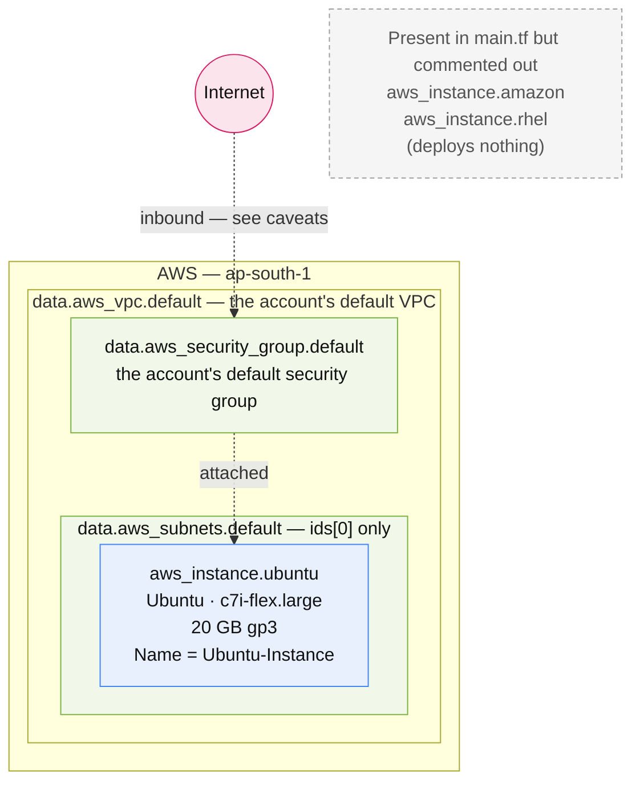

# default-vpc-ubuntu-instance

> The smallest stack in this collection: one Ubuntu EC2 instance in the account's default VPC.

**Region:** `ap-south-1` (hard-coded) · **VPC:** reuses the account default VPC · **Provider:** `hashicorp/aws ~> 6.53` · **Terraform:** `>= 1.6.0`

## What this provisions

A single Ubuntu EC2 instance, placed in the account's existing default VPC using that VPC's default subnet and
default security group. The stack creates no networking whatsoever — every network concern is resolved by lookup.

It is the minimal building block of this repository and the clearest example of the "reuse the default VPC" pattern
that `ansible-control-node-and-workers` also follows, without the multi-node machinery.

This folder began life as a three-OS comparison — Ubuntu, Amazon Linux, and RHEL side by side. The Amazon Linux and
RHEL instance blocks are still present in `main.tf` but are commented out, as are their outputs. **Only the Ubuntu
instance actually deploys.** Two variables (`amazon_ami_id`, `rhel_ami_id`) remain for the disabled instances and are
no longer read by any active resource.

### Resources created

| # | Resource | Terraform address | Key configuration |
|---|----------|-------------------|-------------------|
| 1 | Ubuntu EC2 instance | `aws_instance.ubuntu` | `var.ubuntu_ami_id`, `var.instance_type`, `var.key_name`, subnet `data.aws_subnets.default.ids[0]`, default SG attached, 20 GB `gp3` root volume, tagged `Name = Ubuntu-Instance` |

The instance receives a public IP because the default subnets have `map_public_ip_on_launch` enabled. There is no
Elastic IP, so the address changes if the instance is stopped and started.

### Data sources (lookups only — nothing is created)

| Data source | Purpose |
|-------------|---------|
| `data.aws_vpc.default` | Resolves the account's default VPC. There is no `vpc_id` variable — the stack is hard-wired to whatever the account's default VPC is. |
| `data.aws_subnets.default` | Lists every subnet in that VPC. Only `ids[0]` is used. |
| `data.aws_security_group.default` | Resolves the VPC's default security group by name, which is then attached to the instance. |

Unlike `custom-vpc-public-host`, this stack does **not** look up an AMI. The AMI ID is supplied as a variable.

## Architecture



## Inputs

| Variable | Type | Default | Description |
|----------|------|---------|-------------|
| `ubuntu_ami_id` | `string` | `""` | The AMI ID is of the Ubuntu AMI to use for the EC2 instance |
| `amazon_ami_id` | `string` | `""` | The AMI ID is of the Amazon AMI to use for the EC2 instance *(unused — for the commented-out instance)* |
| `rhel_ami_id` | `string` | `""` | The AMI ID is of the RHEL AMI to use for the EC2 instance *(unused — for the commented-out instance)* |
| `key_name` | `string` | `""` | The key name to use for the EC2 instance |
| `instance_type` | `string` | `""` | The instance type to use for the EC2 instance |

Every variable defaults to an empty string, so the useful configuration lives in `terraform.tfvars`. There is no
validation on any of them — a typo in `instance_type` surfaces as an AWS API error at apply time rather than a plan
error.

Instance type sizing crib, carried over from the code comment:
`t3.micro` = 1 GB · `t3.small` = 2 GB · `c7i-flex.large` = 4 GB · `m7i-flex.large` = 8 GB.

## Outputs

| Output | Description |
|--------|-------------|
| `ubuntu_instance_public_ip` | Public IP of the Ubuntu instance |
| `ubuntu_instance_ssh_command` | Example SSH command for the Ubuntu instance |

Three further outputs (`amazon_instance_public_ip`, `rhel_instance_public_ip`, and the per-instance detail outputs)
are commented out alongside the instances they belong to.

## Prerequisites

- AWS credentials in the environment with permission to run EC2 instances.
- An existing EC2 key pair in `ap-south-1` whose name is passed as `key_name`, with the matching `.pem` on the
  machine you intend to SSH from.
- A **default VPC that still exists** in the account. If it has been deleted, every lookup here fails and the stack
  cannot plan.
- A valid Ubuntu AMI ID for `ap-south-1`. The stack does not look one up, so a stale ID is a real failure mode.

## Deploy

This folder ships `terraform.tfvars.example`, and `terraform.tfvars` itself is gitignored. Copy it into place first:

```bash
cp terraform.tfvars.example terraform.tfvars
```

Then:

```bash
terraform init
terraform plan
terraform apply
```

Every variable in this stack defaults to an empty string, so nothing deploys until the copied file is filled in.

```bash
terraform output ubuntu_instance_ssh_command
```

## Notes and caveats

- **The file header comment is wrong.** `main.tf` opens with "Create 3 EC2 Instances (Ubuntu, Amazon Linux, RHEL)",
  but two of the three are commented out. Only one instance deploys.
- **Two variables are dead.** `amazon_ami_id` and `rhel_ami_id` are still declared and still set in
  `terraform.tfvars`, but no active resource reads them. They are holdovers from the disabled instances.
- **SSH may not work out of the box.** The instance attaches the account's **default** security group, whose AWS
  default has no inbound rule permitting SSH from the internet. The SSH command in the outputs will fail to connect
  unless someone has manually added an inbound rule to that group.
- **No network isolation.** This runs in the account's default VPC, sharing it with anything else in the account that
  also uses the default VPC — including the `ansible-control-node-and-workers` fleet.
- **Single subnet, single AZ.** Only `ids[0]` is used, so the instance sits in one subnet of one availability zone.
- **The instance has no stable IP.** No Elastic IP is allocated, so `public_ip` changes across stop/start.
- **No remote backend.** State is written locally as `terraform.tfstate` and is gitignored, so it is unshared and lost
  with the folder.
